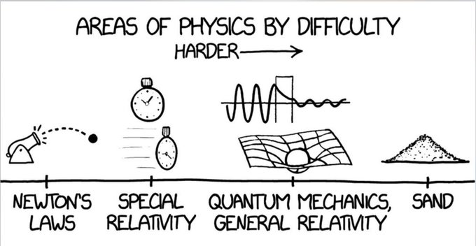

The International Physicists' Tournament (IPT) is a global competition for maths, physics and engineering students. It seeks to develop theoretical and experimental analytical skills through the exploration of 17 open-ended problems. Over a span of six months, participants will design, build, test, and analyze the systems proposed in these challenges, culminating in a presentation at Milan, Italy next spring.

IPT problems are framed to be easily comprehensible, yet they are challenging, often requiring creativity, resourcefulness and a robust grasp of physics to solve.

## An IPT problem from the upcoming IPT
**Ice ice cubey**

Pouring water down on ice cubes can sometimes create a peculiar cracking sound. Why and when do ice cubes crack? How does the sound depend on the ice and water temperatures? What shape of ice produces the loudest cracks?

# Eligibility

As a general requirement, you should be an undergraduate or masters student in a maths, physics or engineering program. That said, feel free to apply if you are enthusiastic about the tournament and think you can bring another perspective to the table.

No specific seniority or prior experience is needed as you'll acquire the knowledge required as you tackle the problems. If physics excites you and you're keen on acquainting yourself with research methods via hands-on experimentation, I'm here to guide you through any required concepts.

# How do I apply?

In order to apply, you must send me a short pre-study (one page long) report on one of the problems of the [IPT problem list](https://ipt.science/problems/). You can choose among the following problems:

    1. The Magnetic Hourglass  
    8. Macroscopic Quasiparticles
    9. Ice ice cubey
    6. Aerodynamic juggler
    16. Ink Boat

In your report, outline your initial approach to the problem. Pose these questions: What process would you follow to solve it? Are there relevant equations or principles to consider? Can you conceive an experimental setup to systematically change the variables of the phenomenon??

Email me the pre-study: [vhg23@cam.ac.uk](mailto:vhg23@cam.ac.uk). I will evaluate applications in a rolling basis until we fill out the six person team.